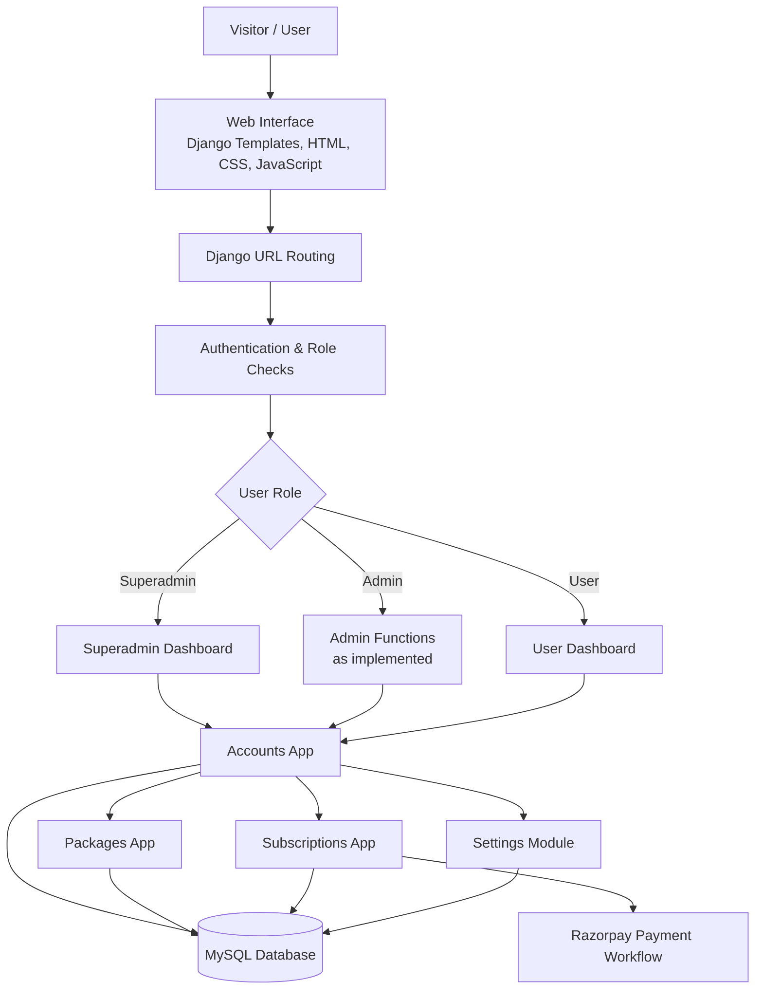

# Role-Based User Management System

A full-stack web application built with **Python and Django** to manage users, role-specific dashboards, packages, subscriptions, and payment-related workflows. The project demonstrates how authentication and role-based access can be organized in a modular web application.

## Architecture Diagram

The diagram below illustrates the main application flow and Django modules.



## Project Overview

The system provides account and role management through a browser-based interface. The codebase is organized into Django apps so that account functionality, package management, subscriptions, and application settings can be maintained separately.

## Key Features

- **Custom user accounts** with role fields, including `superadmin`, `admin`, and `user`
- **Authentication pages** for registration, login, logout, and password recovery
- **OTP-related verification flow**
- **Role-specific dashboards** and profile pages
- **Profile management**, including profile-image support
- **Package management** with package details such as name, price, duration, and description
- **Subscription management** with subscription records and status
- **Payment-related workflow** with Razorpay integration code
- **Application settings** managed through a dedicated Django app
- **Django admin integration** for registered models

*Feature availability and behavior depend on the project's current implementation and configuration. Payment, OTP, and role permissions should be tested before deployment.*

## Technology Stack

| Layer | Technology |
|---|---|
| Backend | Python, Django 5.0.3 |
| Frontend | Django Templates, HTML, CSS, JavaScript |
| Database | MySQL |
| Authentication | Django authentication with a custom user model |
| Payments | Razorpay integration code |
| Version control | Git and GitHub |

## Application Modules

| Module | Responsibility |
|---|---|
| `accounts` | Custom user model, authentication views, profile management, OTP-related pages, and dashboards |
| `packages` | Package models, forms, and package management pages |
| `subscriptions` | Subscription and payment-related workflows |
| `settings_module` | Site/application settings |
| `myproject` | Django project configuration, root URLs, and ASGI/WSGI entry points |

## Repository Structure

```text
Role-Based User Management System/
└── backend/
    ├── manage.py
    ├── myproject/
    │   ├── settings.py
    │   ├── urls.py
    │   ├── asgi.py
    │   └── wsgi.py
    ├── accounts/
    │   ├── models.py
    │   ├── forms.py
    │   ├── views.py
    │   ├── urls.py
    │   ├── templates/accounts/
    │   └── static/accounts/
    ├── packages/
    │   ├── models.py
    │   ├── forms.py
    │   ├── views.py
    │   └── templates/packages/
    ├── subscriptions/
    │   ├── models.py
    │   ├── views.py
    │   ├── middleware.py
    │   └── migrations/
    └── settings_module/
        ├── models.py
        ├── views.py
        └── templates/settings_module/
```

## Getting Started

### Prerequisites

- Python version compatible with Django 5.0.3
- MySQL Server
- `pip`
- Git (optional, if cloning from GitHub)

### 1. Clone the repository

```bash
git clone https://github.com/YOUR-USERNAME/YOUR-REPOSITORY.git
cd "YOUR-REPOSITORY/backend"
```

Replace the placeholder URL and directory name with your actual repository details. If you downloaded a ZIP, extract it and open a terminal in the `backend` directory.

### 2. Create a virtual environment

**Windows PowerShell**

```powershell
python -m venv venv
.\venv\Scripts\Activate.ps1
```

**Linux / macOS**

```bash
python3 -m venv venv
source venv/bin/activate
```

### 3. Install dependencies

The repository should include a `requirements.txt` for reproducible installation. If one is not present, install the dependencies required by the imports in the project. The core framework version is Django 5.0.3; the configured MySQL backend also requires a compatible MySQL Python driver.

For example:

```bash
pip install "Django==5.0.3" mysqlclient
```

Depending on enabled features and your environment, image and payment support may also require packages such as:

```bash
pip install Pillow razorpay
```

After verifying the application works, capture the exact installed dependencies:

```bash
pip freeze > requirements.txt
```

### 4. Configure MySQL

Create a database for the application. For example:

```sql
CREATE DATABASE project CHARACTER SET utf8mb4 COLLATE utf8mb4_unicode_ci;
```

Configure the database name, user, password, host, and port in your local environment. The example database name must match the database name configured in Django settings.

### 5. Configure secrets safely

Before running or publishing the application, configure sensitive values outside version control:

- Django `SECRET_KEY`
- MySQL credentials
- Email/SMTP credentials used by OTP or password-recovery flows
- Razorpay API credentials

Use environment variables or a local configuration file excluded by `.gitignore`. Never publish real secrets in the README, source code, screenshots, or Git history. If a real credential has already been pushed, revoke or rotate it.

### 6. Apply migrations and check configuration

Run commands from the `backend` directory:

```bash
python manage.py check
python manage.py migrate
```

If you intentionally change model definitions, create and review migrations before applying them:

```bash
python manage.py makemigrations
python manage.py migrate
```

### 7. Create a Django admin account

```bash
python manage.py createsuperuser
```

This creates a Django staff/superuser account. The application's own `superadmin` role may be separate, so follow the project's account logic to assign and test application roles securely.

### 8. Start the development server

```bash
python manage.py runserver
```

Open [http://127.0.0.1:8000/](http://127.0.0.1:8000/) in your browser.

These are local development instructions. Actual behavior depends on the configured database, installed dependencies, environment variables, and project settings.

## Roles and Access Control

The custom user model includes these role labels:

- **Superadmin** — highest-level application role intended for platform management
- **Admin** — administrative role, according to the permissions implemented in the project
- **User** — standard account with access to user-facing functionality

A role label by itself does not guarantee security. Ensure every protected backend view checks the authenticated user's permissions. Do not rely only on hiding links or buttons in the frontend.

## Security Checklist

- [ ] Keep `SECRET_KEY`, database credentials, email credentials, and payment secrets out of Git.
- [ ] Rotate any credentials that have previously been exposed.
- [ ] Set `DEBUG = False` and configure `ALLOWED_HOSTS` for production.
- [ ] Enforce authorization checks on every protected view and action.
- [ ] Validate uploaded profile images and restrict file types and sizes.
- [ ] Use HTTPS and secure session-cookie settings in production.
- [ ] Test OTP and password-recovery flows, including expiration and rate limits.
- [ ] Verify payment status on the server; do not trust a client-side success message alone.
- [ ] Review Django's deployment checklist before publishing the application.

## Future Enhancements

- Automated tests for roles, account flows, subscriptions, and payments
- Audit logs for administrative actions
- Search, filtering, and pagination for user/package management
- Robust payment callback/webhook verification
- Deployment guide and environment-variable example file
- Screenshots or a demo link showing the application UI

## Author

**Monali Rajput**

## Disclaimer

This project is intended for educational and portfolio demonstration. Review configuration, permissions, and payment/security workflows carefully before using real user data or deploying it to production.
